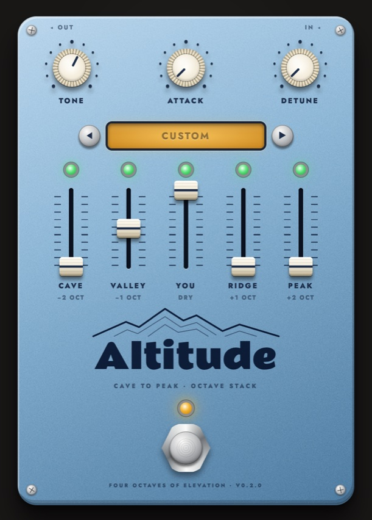

# Altitude



Stacked octaves for guitar, bass, synths or anything else, as a VST3 and
CLAP plugin for macOS and Windows. Five floors mix two octaves down, one
down, your dry signal, one up and two up. It handles chords as well as
single notes, so it does organ stacks as well as bass lines.

## How it works

1. The input is summed to mono. Each octave floor is a granular pitch
   shifter: two read taps sweep a short delay line at the shift rate and
   crossfade, so the jump back is silent. The up floors are low-passed
   first so nothing folds back above Nyquist.
2. Tone low-passes the octave floors only. Your dry signal is never
   filtered.
3. A transient detector catches each pick attack, and Attack fades the
   octave floors back in after it.
4. Detune pushes the octave floors slightly out of tune with each other.

The shifters cost almost no CPU and track chords, with two trade-offs.
Each crossfade restarts the wave at a slightly different phase, which
adds a chorus-like warble on sustained single notes (Tone and Detune help
hide it). And the shifted floors trail the dry signal by about 25 ms
(one octave) to 35 ms (two octaves): fine for pads, bass layers and
recorded parts, a little smeared on tight, fast riffs.

## Controls

| Control | Range | What it does |
|---|---|---|
| Peak | 0–100% | Two octaves up. Glassy, bell-like |
| Ridge | 0–100% | One octave up. 12-string sparkle |
| You | 0–100% | Your dry signal |
| Valley | 0–100% | One octave down. The bass-guitar range |
| Cave | 0–100% | Two octaves down. Sub rumble, felt more than heard |
| Tone | 0–100% | Low-pass on the octave floors, from about 400 Hz to 20 kHz |
| Attack | 0–1000 ms | Fades the octave floors in after each pick attack, for swells. 0 is instant |
| Detune | 0–25 cents | Detunes the octave floors against each other, for chorus or 12-string shimmer |
| Floor lights | On / Off | One above each fader. Off mutes that floor but keeps its level |
| Stomp | On / Off | The footswitch. Off fades the octaves out and passes your signal at full level |

Drag a fader or a knob up or down (hold Shift for fine moves), scroll,
or use the arrow keys. Double-click to reset. A floor's light goes dark
when it's off, and dims while Stomp is off. Level and switch changes
fade over about 20 ms, so they don't click.

## Presets

The ◀ ▶ buttons step through eight presets in the window above the
faders. Loading one sets the faders and knobs, turns every floor on and
leaves Stomp alone, and the host records it like any other control
change. The window shows the preset's name while the controls match it,
and Custom once you change something.

| Preset | Peak | Ridge | You | Valley | Cave | Tone | Attack | Detune |
|---|---|---|---|---|---|---|---|---|
| Bass under guitar | 0 | 0 | 100 | 60 | 0 | 40 | 0 | 0 |
| Organ | 25 | 50 | 70 | 60 | 30 | 55 | 0 | 0 |
| 12-string | 0 | 45 | 100 | 0 | 0 | 80 | 0 | 8 |
| Synth bass | 0 | 0 | 0 | 100 | 50 | 25 | 0 | 0 |
| Doom sub | 0 | 0 | 100 | 70 | 70 | 30 | 0 | 0 |
| Swell pad | 30 | 60 | 40 | 50 | 0 | 50 | 450 | 7 |
| Shimmer | 40 | 50 | 100 | 0 | 0 | 85 | 250 | 5 |
| Chiptune octaves | 40 | 70 | 80 | 0 | 0 | 100 | 0 | 0 |

## Tips

- Set the levels once, then use the floor lights to bring floors in and
  out by song section. Map each one to a MIDI pad in your host for a
  five-button octave pedal.
- Before an amp sim, the amp distorts the whole stack together into a
  fuzzy octave. After it, the stack sits cleanly on top like an organ.
- Octaves down plus high gain gets muddy fast. Bring Tone down to
  30–40%, or high-pass the track a little.
- Attack around 300–600 ms with Ridge and Valley gives a violin-like swell
  under sustained chords. It restarts on every pick, so keep it for slow
  parts.
- The floors add up, so stacking several at 100% gets much louder than
  the input. Watch the meter.

## Installing

Download the zip from
[Releases](https://github.com/starzonmyarmz/altitude/releases) and follow
`INSTALL.txt` inside it.

## Building

```sh
cargo xtask bundle altitude --release         # target/bundled/Altitude.{vst3,clap}
scripts/install.sh                         # bundle, sign ad hoc and install on macOS
scripts/clap-validator.sh target/bundled/Altitude.clap
```

## Tests

`cargo test` runs the engine offline: a guitar DI rendered against
stored golden renders (an organ-style stack and a slow, detuned swell),
plus synthetic tests for pitch, the switches, the footswitch and
silence. After an intended change to the sound, rerun with `BLESS=1` to
rewrite the renders, and listen to them before committing.

## Working on the UI

The editor is a webview showing `ui/index.html`, which is compiled into
the plugin. Without the plugin, the page runs against a mock, so you can
work on it in a browser:

```sh
cd ui && python3 -m http.server 8765    # open http://127.0.0.1:8765
```

Add `?version=1.2.0` to show a version other than `0.0.0`. To load
the page live in the plugin, set `ALTITUDE_UI_URL` to that URL
before starting the host.

## CI and releases

- `check.yml` runs on pushes to main and on PRs: the tests and
  clap-validator on macOS, and clap-validator on the Windows build.
- `release.yml` runs on `vX.Y.Z` tags. The tag must match `version` in
  the root `Cargo.toml`. It builds a universal macOS bundle and a
  Windows bundle, validates both, and publishes `Altitude-X.Y.Z.zip`
  with `INSTALL.txt`.
- `screenshot.yml` runs on pushes to main that touch `ui/`, the version
  or `plugin/src/lib.rs`. It retakes `docs/altitude.jpg` with
  `scripts/screenshot.sh`, sets its width in the README, and commits both
  if the image changed.

## Built with

- [nice-plug](https://codeberg.org/RustAudio/nice-plug), pinned to
  [a fork](https://github.com/starzonmyarmz/nice-plug/tree/patina) that
  adds `ActivateContext::gui_context()`.
- [Rammetto One](https://fonts.google.com/specimen/Rammetto+One) by Rammetto Project Authors and
  [Jost](https://github.com/indestructible-type/Jost) by Owen Earl,
  under the SIL Open Font License (`ui/fonts`).
- Started from
  [plugin-template](https://github.com/starzonmyarmz/plugin-template).
